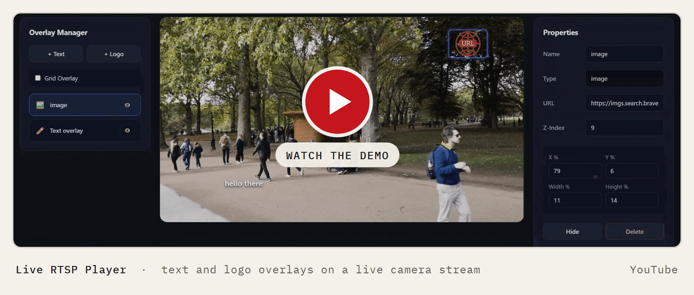

# Live RTSP Player

Watch a live IP-camera stream in an ordinary browser tab, and place text or a logo on top of it by dragging them where you want.

[](https://youtu.be/xvfvlg0qy0E)

Flask · FFmpeg · MongoDB · React (Vite) · hls.js · Built for a full-stack developer assessment, October 2025

## What it does

- Plays any RTSP stream in the browser. RTSP is the protocol most IP cameras use, and browsers can't play it on their own.
- Adds text and logo overlays you can drag, resize, nudge with the arrow keys, hide or delete. Logos come from an image URL.
- A side panel edits each overlay's text or image URL, stacking order, position and size. A grid option snaps boxes to 5% steps.
- Saves every overlay to MongoDB through a small REST API, so the layout comes back when you reload the page.

## How it works


HLS is a streaming format browsers can play: a playlist file plus short video chunks. The API has two stream routes, `POST /api/stream/start` and `POST /api/stream/stop`, plus create, read, update and delete routes under `/api/overlays`.

## Run it

You need Python 3.8+, Node 20.19+, MongoDB running on `localhost:27017` and FFmpeg on your PATH. No API keys.

```bash
cd backend
pip install -r requirements.txt
python app.py          # API on http://localhost:5000
```

```bash
cd frontend
npm install
npm run dev            # app on http://localhost:5173
```

Open http://localhost:5173, paste an RTSP URL and press **Start Stream**.

No camera? Start [MediaMTX](https://github.com/bluenviron/mediamtx) (a small RTSP server) and loop a video file into it:

```bash
ffmpeg -re -stream_loop -1 -i sample.mp4 -c copy -f rtsp rtsp://localhost:8554/live
```

The **Use Sample** button fills in that address. On Windows, `backend/start_mediamtx.bat` and `backend/stream_video.bat` do the same; edit the folder and video paths in them first.

## Limits

- Written on Windows for a developer assessment. There are no automated tests.
- Every stream is re-encoded to H.264 with libx264, which costs CPU. There's no pass-through mode.
- Playback runs behind the live camera, because the browser plays finished 2-second chunks.
- Overlays are one shared set for all streams, and there's no login.
- Two backend routes, `/api/streams` and `/api/stream/restart`, are unfinished and return errors. The page doesn't use them.

---

Built by [Manveen Singh](https://manveen.me)
